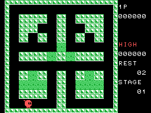
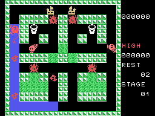
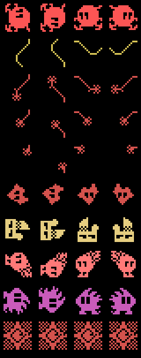
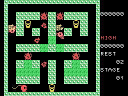
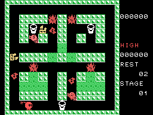

# The game

Sparkie is a spark running through a 24 x 24 maze. Every square it steps on is
**painted blue** (`mueve_sparkie`, 0x0416), and the maze holds flames that
release fire enemies. A stage ends in two ways (`bucle_principal`, 0x0134):
with **every square painted** or with **every enemy put out**. And there is a
clock: at 4,096 frames (68 s) **TIME OVER** comes up and the stage ends all the
same, with the painting bonus.

Every GIF on this page is the cartridge **running in openMSX**: on every frame
the VRAM and the VDP registers are logged, and `tools/vdp.py` paints them.
Each picture lasts as long as it lasted in the emulator.

## Sparkie, the bucket and the wave

With the button, if there is a **bucket** two squares ahead, Sparkie empties it
(`boton`, 0x0421): the bucket vanishes, its four squares -which were wall-
open up, and a **wave** comes out that runs back **towards Sparkie**, opposite
to the way it faces, one square per step, up to ten squares or until a wall
(`paso_de_ola`, 0x045E). The wave
**puts out every enemy it touches** (1,000 points each) and gives Sparkie its
**full charge** back.

## The charge

Sparkie has **three points of charge** (bits 0-1 of `0xE004`). An enemy
touching its tail takes one away (`quita_carga`, 0x0787), and from then on
**another one goes every 174 frames** (2.9 s) until it reaches zero and Sparkie
goes out (`carga_de_sparkie`, 0x051F). While the charge is short the buckets
flash white and magenta (`pinta_cubos`, 0x0915), the tail shrinks and the
warning plays. A bucket fills it up again.

## The shots

With no bucket ahead, the button releases **four shots** in a row on the
squares ahead (`dispara`, 0x04E4). Each shot takes one life point from the
first enemy it touches (`disparos_dan`, 0x0D24). A wounded enemy **stands
still** -white with one life point, light blue with two- and gets one back
every 50 steps (`herido`, 0x0765). With no life left it **is blown away** the
way Sparkie faces (100 or 200 points) until it hits a wall, and there it goes
out (`vuela`, 0x0CAC).

## The flames and the enemies

Each maze has up to **five flames**. The big flame **kills Sparkie** if it
touches it and, every eight even frames, a random one may release a **small
flame** (`suelta_llamita`, 0x0985). Each shot takes away one point of size; at
zero it goes out (300 points). With fewer than five enemies in play the flames
also wear down on their own, and the ones that are not whole grow back
(`mueve_llamas`, 0x0565).

The enemies are **13 slots** in four batches (`mueve_enemigos`, 0x0654). All of
them chase Sparkie: at every junction they choose, without turning back, the
way that brings them closer, vertically or horizontally as the R register's
randomness decides, and otherwise a free one at random
(`sentido_del_enemigo`, 0x188C). At 2,048 frames into the stage (34 s) they all
move at two pixels per step. And no more than four fit in a band of two rows
(`franja_llena`, 0x0949).

| Row | What it is | Pattern and colour (0x0B82) |
|---|---|---|
| 1 | Sparkie | 0x74, red |
| 2 | its tail with full charge | 0x94, yellow |
| 3-5 | the tail with 2, 1 and 0 points | 0xE4, 0xD4, 0xC4, red |
| 6 | batch 1: the small flame a big flame releases; it does not kill, it moves at two pixels per step | 0x04, red |
| 7 | batch 2 | 0x34, light yellow |
| 8 | batch 4 | 0x14, light red |
| 9 | batch 8: a single one, and it **paints the floor** like Sparkie | 0x54, magenta |
| 10 | Sparkie's explosion | 0x00, red |

The cartridge keeps every figure facing left and rotates it at start-up
(`carga_figura`, 0x1154); every eight frames it switches between two drawings,
except the small flame. The patterns that come out of running that loader are
**identical** to openMSX's (0 bytes different out of 2,048).

## The objects

## The burning blocks

Each maze has green **blocks**, and up to four groups of them can burn
(`bloques_que_arden`, 0x07A3). With fewer than five enemies, every 32 frames a
group that has not burnt yet is picked at random: its blocks flash red and
yellow for 128 frames, **turn into corridor** and a new enemy comes out of the
first square.

## The bonus

When only **one bucket** is left, the **bonus** appears on its square in the
middle (`premio_sale`, 0x0639). It stays 255 steps (510 frames), and if Sparkie
touches it it gives **1,000 points per stage** up to the ninth and 10,000 from
the tenth (`puntos_premio`, 0x0EC9). The GIF is recorded with two of the three
buckets marked as taken (their state set to zero with a poke): the cartridge
does the rest.

## The points

The score shows four digits and the two zeros after them are a fixed caption:
**points come in hundreds**. One extra life at 30,000, only once.

| | Points |
|---|---|
| an enemy put out by the wave | 1,000 |
| a flame put out | 300 |
| a small flame blown away / any other enemy blown away | 100 / 200 |
| the bonus | 1,000 per stage (10,000 from the tenth) |
| at the end of the stage, everything painted | 10,000 |
| at the end of the stage, squares left unpainted | (500 - squares) / 10 hundreds |

## TIME OVER and GAME OVER

The TIME OVER GIF is recorded with the stage counter moved forward to 0x0FC0
with a poke: the caption appears 64 frames later. Behind it, the next stage.
The GAME OVER one, with a single life.

## One or two players, joystick or keyboard

The menu offers four options (`pon_menu`, 0x020C): one or two players, with the
joystick (each player on their own port) or with the cursor keys and the space
bar. With two, they take turns at every life, and each one has their maze,
points and lives kept in RAM (`cambia_jugador`, 0x0E5D).
