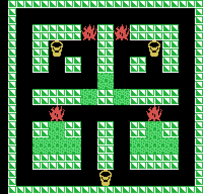
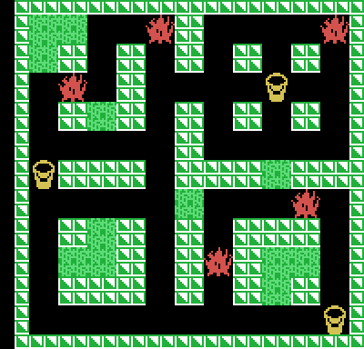
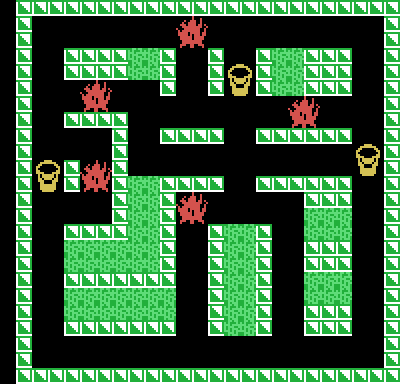
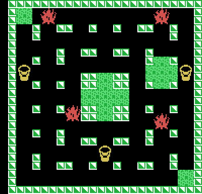

# The mazes

**There are four, and only four.** `laberinto_de_fase` (0x0AA9) picks the
stage's maze with `stage & 3`: the fifth repeats the first, the sixth the
second, and so on forever. Measured in openMSX: stage 5 comes up with maze 1,
byte for byte. From one round to the next the bonus in the middle changes
(1,000 points per stage up to the ninth, 10,000 from the tenth); the mazes do
not.

The pictures are **drawn from the ROM** with `tools/laberintos.py`, which does
the same as `desempaqueta_laberinto` (0x09D0) and `pinta_fase` (0x02AB): the
72-byte map, one bit per square (24 rows of 3 bytes, 1 wall and 0 corridor),
the blocks, and on top the buckets and the big flames. **Checked against the
openMSX VRAM** at the start of each stage: 0 bytes different in mazes 1 and 2;
in 3 and 4, only the four squares where the batch 8 enemy is born, which it
paints blue on its first step (see [Curiosities](CURIOSITIES.html)).

After the map, each maze brings its three buckets, its five flames (an empty
slot if there are four), its nine starting enemies, the bonus square and the
blocks, in groups: the groups go into the four lists of blocks that can burn;
the rest are blocks forever.

## Maze 1

`0x19E2`: 288 corridor squares to paint, 4 flames, 4 enemies (two of batch 2
at the top and two of batch 4 in the middle), 11 blocks in 5 groups (the ones
that burn: 1, 1, 1 and 4 blocks). The bonus, on square (11, 13).

## Maze 2

`0x1A6A`: 280 squares to paint, 5 flames, 4 enemies (two of batch 2 and two of
batch 4), 12 blocks in 6 groups (burning: 1, 3, 1 and 1). Bonus on (9, 9).

## Maze 3

`0x1AF5`: 292 squares to paint, 5 flames, 6 enemies (three of batch 2, two of
batch 4 and the batch 8 one), 20 blocks in 7 groups (burning: 2, 1, 2 and 4).
Bonus on (13, 9).

## Maze 4

`0x1B91`: 368 squares to paint, 4 flames, 6 enemies (three of batch 2, two of
batch 4 and the batch 8 one), 11 blocks in 3 groups. The first one brings 9
blocks in a row, and the copy into the lists, ten bytes at most (0x0A3D), splits
it exactly in two: the cross in the middle (5) and the diamond on the right
(4). So four lists burn: 5, 4, 1 and 1. Bonus on (11, 15).

## How they are stored

| Bytes | What |
|---|---|
| 72 | the map: 24 rows of 3 bytes, bit 7 of the first one is column 0 |
| 6 | the three buckets (X, Y in squares); they cover four wall squares, which open when taken |
| 10 | the five flames (X, Y in squares; 0, 0 if none) |
| 18 | the nine enemies (X, Y in pixels; 0, 0 if none): four of batch 2, four of batch 4 and the batch 8 one |
| 2 | the bonus square |
| the rest | the blocks (X, Y), in groups separated by a zero; two zeros end it |

In RAM the maze lives at `0xE12C`: 24 rows of 6 bytes, four two-bit squares
per byte, with 0 corridor, 1 painted, 2 block and 3 wall (`casilla_en_ram`,
0x142E).
