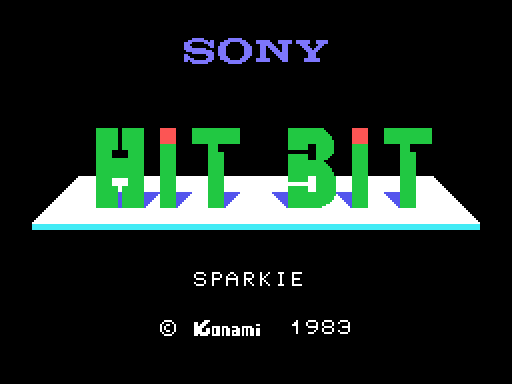
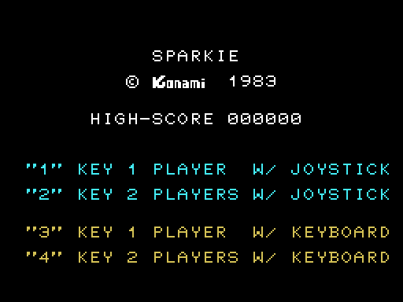
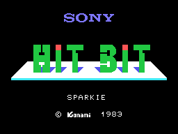
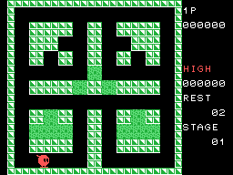

# The sequences

## The Sony screen and the menu

At power-up the **Sony HIT BIT** screen comes up with "SPARKIE" and "(C) Konami
1983" (`pantalla_de_sony`, 0x10EA), in SCREEN 1, for about four seconds. Then
the menu, already in SCREEN 2 (`pon_menu`, 0x020C): the high score and the four
options. If nobody presses 1 to 4 within 85 waiting rounds (about 14 s), the
demo starts; with the button of joystick 1 or the space bar, the game.

Both pictures come from **running the cartridge itself** with
`tools/pantallas.py`: the VRAM those routines leave is **identical** to
openMSX's (0 bytes different out of 16,384 in each, and the eight registers
equal).

The GIF is the start-up recorded in openMSX: both screens as long as they last.

## The demo

In the demo the "joystick" is the set of free directions of the square Sparkie
is on (`guarda_mando`, 0x0F5E): it goes wherever it can, without the button,
**without sound** (the PSG is silenced every frame) and without showing the
lives. It ends when Sparkie dies, or with the button, which starts a game; and
it goes back to the menu.

