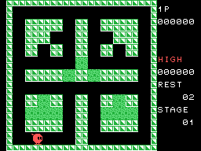
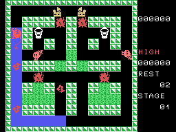
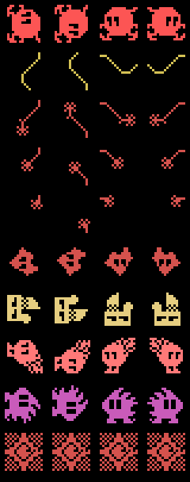
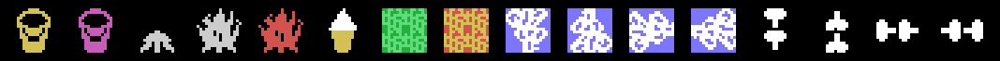
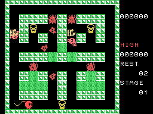
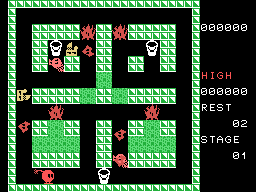

# La partida

Sparkie es una chispa que recorre un laberinto de 24 x 24 casillas. Cada
casilla que pisa queda **pintada de azul** (`mueve_sparkie`, 0x0416), y en el
laberinto hay llamas que sueltan enemigos de fuego. La fase se acaba de dos
maneras (`bucle_principal`, 0x0134): con **todas las casillas pintadas** o con
**todos los enemigos apagados**. Y hay un reloj: a los 4.096 cuadros (68 s)
sale **TIME OVER** y la fase se da por acabada igual, con el premio de lo pintado.

Todos los GIF de esta página son el cartucho **funcionando en openMSX**: en
cada cuadro se apuntan la VRAM y los registros del VDP, y `tools/vdp.py` los
pinta. Cada imagen dura lo que duró en el emulador.

## Sparkie, el cubo y la ola

Con el botón, si hay un **cubo** dos casillas por delante, Sparkie lo vacía
(`boton`, 0x0421): el cubo desaparece, sus cuatro casillas -que eran muro- se
abren, y sale una **ola** que vuelve **hacia Sparkie**, en sentido contrario al
que mira, una casilla por paso, hasta diez casillas o hasta un muro
(`paso_de_ola`, 0x045E). La ola
**apaga a los enemigos que toca** (1.000 puntos cada uno) y le devuelve a
Sparkie **la carga entera**.

## La carga

Sparkie tiene **tres puntos de carga** (los bits 0-1 de `0xE004`). Un enemigo
que le toca la cola le quita uno (`quita_carga`, 0x0787), y a partir de ahí se
gasta **otro cada 174 cuadros** (2,9 s) hasta que llega a cero y Sparkie se
apaga (`carga_de_sparkie`, 0x051F). Mientras le falta carga, los cubos
parpadean en blanco y magenta (`pinta_cubos`, 0x0915), la cola se acorta y
suena el aviso. Un cubo la rellena.

## Los disparos

Sin un cubo delante, el botón suelta **cuatro disparos** seguidos en las
casillas de delante (`dispara`, 0x04E4). Cada disparo quita un punto de vida
al primer enemigo que toca (`disparos_dan`, 0x0D24). Un enemigo herido **se
queda quieto** -blanco con un punto de vida, azul claro con dos- y recupera
uno cada 50 pasos (`herido`, 0x0765). Sin vida, **sale despedido** hacia donde
mira Sparkie (100 o 200 puntos) hasta chocar con un muro, y ahí se apaga
(`vuela`, 0x0CAC).

## Las llamas y los enemigos

Cada laberinto trae hasta **cinco llamas**. La llama grande **mata a Sparkie**
si la toca y, cada ocho cuadros pares, una al azar puede soltar una
**llamita** (`suelta_llamita`, 0x0985). Cada disparo le quita un punto de
tamaño; a cero se apaga (300 puntos). Con menos de cinco enemigos en juego, las
llamas también se gastan solas, y las que no están enteras vuelven a crecer
(`mueve_llamas`, 0x0565).

Los enemigos son **13 huecos** en cuatro tandas (`mueve_enemigos`, 0x0654).
Todos persiguen a Sparkie: en cada cruce eligen, sin dar la vuelta, el sentido
que les acerca, en vertical o en horizontal según el azar del registro R, y si
no, uno libre al azar (`sentido_del_enemigo`, 0x188C). A los 2.048 cuadros
de la fase (34 s) todos pasan a dos puntos por paso. Y no caben más de cuatro
en una franja de dos filas (`franja_llena`, 0x0949).

| Fila | Qué es | Patrón y color (0x0B82) |
|---|---|---|
| 1 | Sparkie | 0x74, rojo |
| 2 | su cola con la carga entera | 0x94, amarillo |
| 3-5 | la cola con 2, 1 y 0 puntos | 0xE4, 0xD4, 0xC4, rojo |
| 6 | tanda 1: la llamita que suelta una llama grande; no mata, va a dos puntos por paso | 0x04, rojo |
| 7 | tanda 2 | 0x34, amarillo claro |
| 8 | tanda 4 | 0x14, rojo claro |
| 9 | tanda 8: uno solo, y **pinta el suelo** como Sparkie | 0x54, magenta |
| 10 | la explosión de Sparkie | 0x00, rojo |

El cartucho guarda cada figura mirando a la izquierda y la gira al arrancar
(`carga_figura`, 0x1154); cada ocho cuadros alterna entre dos dibujos, menos la
llamita. Los patrones que salen de ejecutar ese cargador son **idénticos** a
los de openMSX (0 bytes distintos de 2.048).

## Los objetos

## Los bloques que arden

Cada laberinto trae **bloques** verdes, y hasta cuatro grupos de ellos pueden
arder (`bloques_que_arden`, 0x07A3). Con menos de cinco enemigos, cada 32
cuadros se elige al azar un grupo que no haya ardido: sus bloques parpadean en
rojo y amarillo durante 128 cuadros, **se vuelven pasillo** y de la primera
casilla sale un enemigo nuevo.

## El premio

Cuando solo queda **un cubo**, sale el **premio** en su casilla del centro
(`premio_sale`, 0x0639). Se queda 255 pasos (510 cuadros), y si Sparkie lo toca da
**1.000 puntos por fase** hasta la novena y 10.000 desde la décima
(`puntos_premio`, 0x0EC9). El GIF está grabado con dos de los tres cubos dados
por cogidos (su estado a cero con un poke): lo demás lo hace el cartucho.

## Los puntos

El marcador pinta cuatro cifras y los dos ceros de detrás son un rótulo fijo:
**los puntos van por centenas**. Una vida más a los 30.000, una sola vez.

| | Puntos |
|---|---|
| un enemigo apagado por la ola | 1.000 |
| una llama apagada | 300 |
| una llamita despedida / cualquier otro enemigo despedido | 100 / 200 |
| el premio | 1.000 por fase (10.000 desde la décima) |
| al acabar la fase, todo pintado | 10.000 |
| al acabar la fase, con casillas sin pintar | (500 - casillas) / 10 centenas |

## TIME OVER y GAME OVER

El GIF de TIME OVER está grabado con la cuenta de la fase adelantada a 0x0FC0
con un poke: el cartel sale 64 cuadros después. Detrás, la fase siguiente. El
de GAME OVER, con una sola vida.

## Uno o dos jugadores, mando o teclado

El menú da cuatro opciones (`pon_menu`, 0x020C): uno o dos jugadores, con el
mando (cada jugador en su puerto) o con los cursores y la barra. Con dos, se
turnan a cada vida, y cada uno tiene su laberinto, sus puntos y sus vidas
guardados en la RAM (`cambia_jugador`, 0x0E5D).
