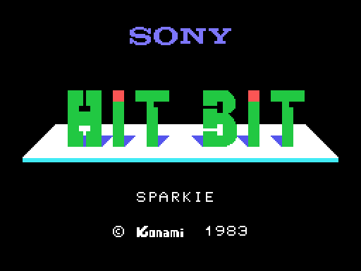
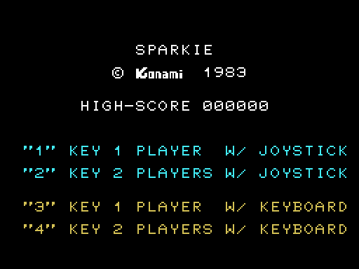
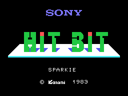
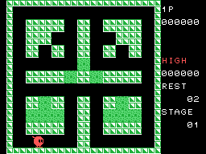

# Las secuencias

## La pantalla de Sony y el menú

Al encender sale la pantalla de **Sony HIT BIT** con "SPARKIE" y "(C) Konami
1983" (`pantalla_de_sony`, 0x10EA), en SCREEN 1, unos cuatro segundos. Luego el
menú, ya en SCREEN 2 (`pon_menu`, 0x020C): el récord y las cuatro opciones.
Si nadie pulsa del 1 al 4 en 85 vueltas de espera (unos 14 s), empieza la
demostración; con el botón del mando 1 o la barra, la partida.

Las dos imágenes salen de **ejecutar el propio cartucho** con
`tools/pantallas.py`: la VRAM que dejan esas rutinas es **idéntica** a la de
openMSX (0 bytes distintos de 16.384 en cada una, y los ocho registros
iguales).

El GIF es el arranque grabado en openMSX: las dos pantallas tal como duran.

## La demostración

En la demostración el "mando" son los sentidos libres de la casilla en la que
está Sparkie (`guarda_mando`, 0x0F5E): va por donde puede, sin el botón, **sin
sonido** (el PSG se calla en cada cuadro) y sin mostrar las vidas. Se acaba
cuando Sparkie muere, o con el botón, que empieza una partida; y vuelve al
menú.

