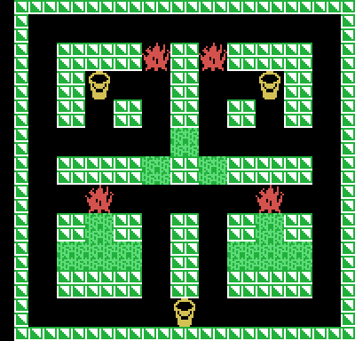
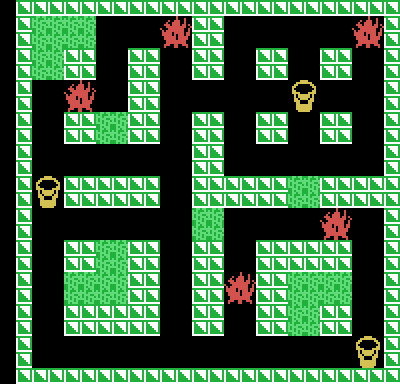
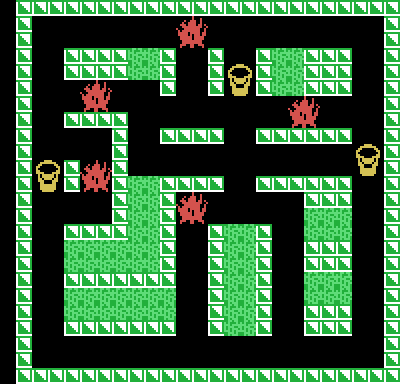
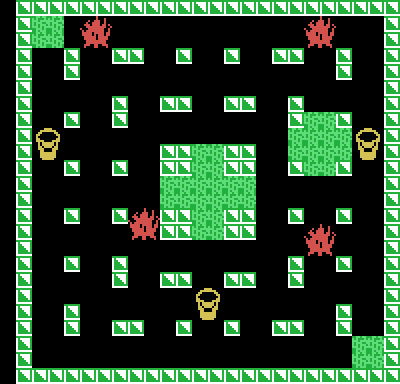

# Los laberintos

**Hay cuatro, y solo cuatro.** `laberinto_de_fase` (0x0AA9) elige el de la fase
con `fase & 3`: la quinta repite el primero, la sexta el segundo, y así
siempre. Lo medido en openMSX: la fase 5 sale con el laberinto 1, byte a byte.
De una vuelta a otra cambia el premio del centro (1.000 puntos por fase hasta
la novena, 10.000 desde la décima); los laberintos, no.

Las imágenes están **dibujadas desde la ROM** con `tools/laberintos.py`, que
hace lo mismo que `desempaqueta_laberinto` (0x09D0) y `pinta_fase` (0x02AB):
el mapa de 72 bytes, un bit por casilla (24 filas de 3 bytes, 1 muro y 0
pasillo), los bloques, y encima los cubos y las llamas grandes. **Cotejadas
con la VRAM de openMSX** al empezar cada fase: 0 bytes distintos en los
laberintos 1 y 2; en el 3 y el 4, solo las cuatro casillas en las que nace el
enemigo de la tanda 8, que las pinta de azul en su primer paso (ver
[Curiosidades](CURIOSIDADES.html)).

Cada laberinto trae detrás del mapa sus tres cubos, sus cinco llamas (un
hueco vacío si son cuatro), sus nueve enemigos de salida, la casilla del
premio y los bloques, por grupos: los grupos pasan a las cuatro listas de
bloques que pueden arder; lo que no cabe en ellas son bloques para siempre.

## Laberinto 1

`0x19E2`: 288 casillas de pasillo por pintar, 4 llamas, 4 enemigos (dos de la
tanda 2 arriba y dos de la tanda 4 en medio), 11 bloques en 5 grupos (los que
arden: 1, 1, 1 y 4 bloques). El premio, en la casilla (11, 13).

## Laberinto 2

`0x1A6A`: 280 casillas por pintar, 5 llamas, 4 enemigos (dos de la tanda 2 y
dos de la tanda 4), 12 bloques en 6 grupos (arden: 1, 3, 1 y 1). Premio en
(9, 9).

## Laberinto 3

`0x1AF5`: 292 casillas por pintar, 5 llamas, 6 enemigos (tres de la tanda 2,
dos de la tanda 4 y el de la tanda 8), 20 bloques en 7 grupos (arden: 2, 1, 2
y 4). Premio en (13, 9).

## Laberinto 4

`0x1B91`: 368 casillas por pintar, 4 llamas, 6 enemigos (tres de la tanda 2,
dos de la tanda 4 y el de la tanda 8), 11 bloques en 3 grupos. El primero
trae 9 bloques seguidos, y la copia a las listas, de diez bytes como mucho
(0x0A3D), lo parte justo en dos: la cruz del centro (5) y el rombo de la
derecha (4). Arden, pues, cuatro listas: 5, 4, 1 y 1. Premio en (11, 15).

## Cómo están guardados

| Bytes | Qué |
|---|---|
| 72 | el mapa: 24 filas de 3 bytes, el bit 7 del primero es la columna 0 |
| 6 | los tres cubos (X, Y en casillas); tapan cuatro casillas de muro, que se abren al cogerlos |
| 10 | las cinco llamas (X, Y en casillas; 0, 0 si no hay) |
| 18 | los nueve enemigos (X, Y en puntos; 0, 0 si no hay): cuatro de la tanda 2, cuatro de la tanda 4 y el de la tanda 8 |
| 2 | la casilla del premio |
| el resto | los bloques (X, Y), por grupos separados por un cero; dos ceros acaban |

En la RAM, el laberinto vive en `0xE12C`: 24 filas de 6 bytes, cuatro casillas
de dos bits por byte, con 0 pasillo, 1 pintado, 2 bloque y 3 muro
(`casilla_en_ram`, 0x142E).
